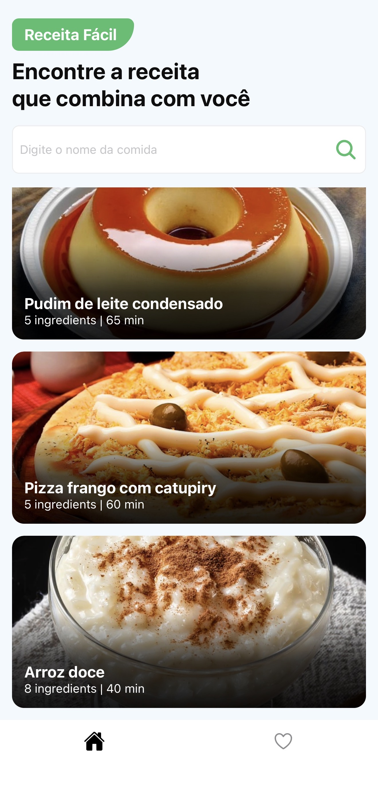
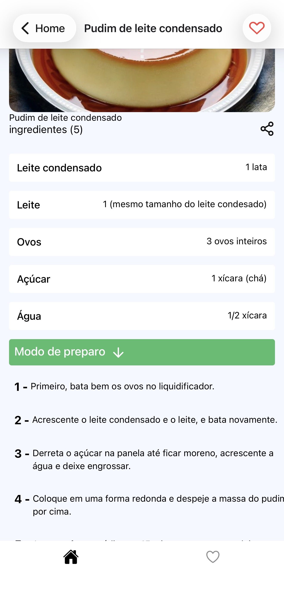
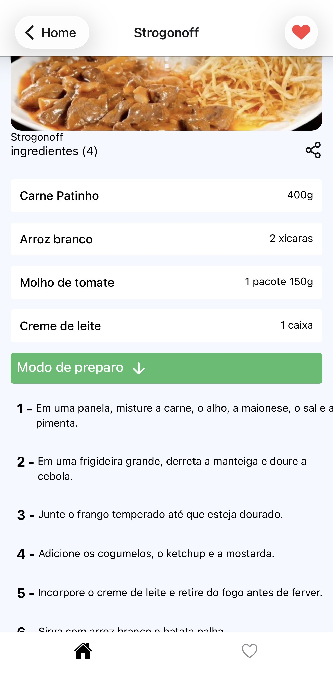
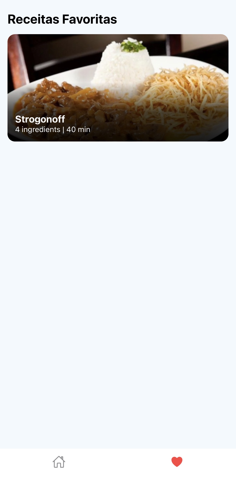

# 🍽️ Receita Fácil

Aplicativo mobile de receitas desenvolvido com **React Native** e **Expo**. Navegue pelas receitas, veja os detalhes de cada uma e salve o que mais gostou, tudo em uma interface fluida, com animações e navegação por abas.


<!-- Prints do app -->
<p align="center">
  
  
  
  
</p>

## ✨ Funcionalidades

- Listagem de receitas consumindo uma API (Axios)
- Busca de receitas pelo nome
- Tela de favoritos persistida no dispositivo com AsyncStorage
- Navegação por abas (bottom tabs) e entre telas (native stack)
- Animações suaves com Moti e Reanimated
- Fundos com gradiente (`expo-linear-gradient`)
- Exibição de conteúdo web dentro do app (WebView)
- Funciona em Android, iOS e web

## 🛠️ Tecnologias

| Categoria | Tecnologia |
|---|---|
| Framework | [React Native](https://reactnative.dev/) 0.88 + [Expo](https://expo.dev/) 58 |
| Linguagem | JavaScript (ES6+) |
| Navegação | [React Navigation](https://reactnavigation.org/) (bottom tabs + native stack) |
| Requisições HTTP | [Axios](https://axios-http.com/) |
| Armazenamento local | [AsyncStorage](https://react-native-async-storage.github.io/async-storage/) |
| Animações | [Moti](https://moti.fyi/), [Reanimated](https://docs.swmansion.com/react-native-reanimated/) 4, Gesture Handler |
| Interface | Expo Linear Gradient, Safe Area Context, React Native Screens, WebView |
| Dados (desenvolvimento) | `db.json` como API simulada |

## 📁 Estrutura do projeto

```
projeto-app-receita-facil/
├── assets/          # Imagens, ícones e recursos estáticos
├── src/             # Código-fonte do app (telas, componentes, serviços)
├── App.js           # Ponto de entrada do aplicativo
├── app.json         # Configuração do Expo
├── babel.config.js  # Configuração do Babel
├── db.json          # Base de dados da API simulada
└── package.json     # Dependências e scripts
```

## 🚀 Como executar

### Pré-requisitos

- [Node.js](https://nodejs.org/) 20 LTS (ou superior)
- npm
- Aplicativo **Expo Go** no celular ([Android](https://play.google.com/store/apps/details?id=host.exp.exponent) / [iOS](https://apps.apple.com/app/expo-go/id982107779)), ou um emulador Android/iOS configurado

### Instalação

```bash
# Clone o repositório
git clone https://github.com/guilhermefdias/projeto-app-receita-facil.git

# Entre na pasta do projeto
cd projeto-app-receita-facil

# Instale as dependências
npm install
```

### API simulada

O arquivo `db.json` contém os dados das receitas. Para servi-lo localmente com o [json-server](https://github.com/typicode/json-server):

```bash
npx json-server --watch db.json --port 3000
```

> 💡 **Testando em um celular físico?** O endereço `localhost` não funciona no aparelho. Use o IP da sua máquina na rede local (por exemplo `http://192.168.0.10:3000`) na configuração da URL base do Axios, e deixe o celular e o computador na mesma rede Wi-Fi.

### Iniciando o app

```bash
npm start
```

Escaneie o QR Code com o Expo Go (Android) ou com a câmera (iOS). Também é possível rodar direto em uma plataforma:

| Comando | Plataforma |
|---|---|
| `npm run android` | Emulador/dispositivo Android |
| `npm run ios` | Simulador iOS (requer macOS) |
| `npm run web` | Navegador |

## 🗺️ Próximos passos

- [ ] Filtro de receitas por categoria
- [ ] Testes automatizados
- [ ] Publicação do app

## 👨‍💻 Autor

**Guilherme Dias**

- GitHub: [@guilhermefdias](https://github.com/guilhermefdias)
- LinkedIn: [guilhermefdias](https://www.linkedin.com/in/guilhermefdias/)

---

Feito com ☕ e React Native.